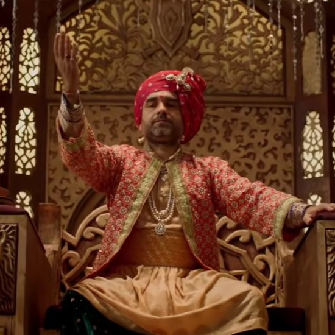

# Music — Offline Audio Studio

<p align="center">
  
</p>

<p align="center">
  A sleek, high-performance, and feature-rich offline music player built with Flutter, GetX, and native Android audio integrations. Designed for speed, audio fidelity, and seamless offline library management.
</p>

<p align="center">
  
  
  
  
  
  
</p>

---

## ⚡ Key Features

### 🚀 Instant-Launch & Stale-While-Revalidate Engine

- **Sub-3ms Startup**: Utilizes an ultra-low latency Hive key-value cache to instantly load your song library upon app launch without freezing on a splash screen.
- **Background MediaStore Synchronization**: Android MediaStore is queried asynchronously in the background, updating library additions or deletions seamlessly without blocking UI interaction.
- **Snappy Branded Splash**: 300ms native animated entrance with instant permission checks.

### 🎧 Studio Audio Playback & Persistent Sessions

- **Session Continuity**: Retains your exact playing track, playlist queue, elapsed playback duration, playback speed, and loop/shuffle preferences across app kills and reboots.
- **Background Audio & Lockscreen Controls**: Powered by `just_audio_background` and Android `AudioService` with system notification controls (Play/Pause, Next, Previous).
- **Custom Visualizers**: Generates dynamic album artwork and notification audio wave visuals on the fly.
- **Fine-Grained Controls**: Variable playback speed selector (0.5x – 2.0x), repeat modes (Repeat Off, Repeat All, and continuous Repeat One), and shuffle.

### 📦 Multi-Select, Native Sharing & Safe Deletion

- **Batch Multi-Selection**: Long-press any song tile or use the 3-dot action menu to enter multi-selection mode with select-all and deselect-all capabilities.
- **Native File Sharing**: Direct integration with Android's `FileProvider` (`androidx.core.content.FileProvider`) allows sharing single or multiple audio files simultaneously via Bluetooth, Nearby Share, WhatsApp, Telegram, or email.
- **Double-Layer Safety Deletion**: Delete single or batch tracks directly from the device's physical storage and Android MediaStore with confirmation warning dialogs preventing accidental file loss.

### 🎨 Modern Adaptive UI & Full-Bleed Launcher Icons

- **Edge-to-Edge Adaptive Icons**: Fully compliant with Android Adaptive Icon standards (`mipmap-anydpi-v26`) ensuring edge-to-edge coverage with **zero white padding or borders** across all Android launchers (Samsung One UI, Pixel Launcher, MIUI/HyperOS, OxygenOS).
- **Dynamic Active Track Highlights**: The currently active and playing song features a distinct accent color and live playing indicators.
- **Fast Alphabet Indexer (A–Z)**: Smooth vertical drag scrollbar for rapid jumping through thousands of songs alphabetically.
- **Full Dark / Light Theming**: High-contrast dark mode and clean light mode powered by reactive GetX controllers.
- **Pure Native Flutter Animations**: Zero heavy third-party animation assets (no Lottie dependencies) for maximum framerate and minimal APK size.

---

## 🛠️ Architecture & Tech Stack

| Layer                  | Technology                                                                                                                  | Purpose                                                                  |
| :--------------------- | :-------------------------------------------------------------------------------------------------------------------------- | :----------------------------------------------------------------------- |
| **Framework**          | [Flutter](https://flutter.dev)                                                                                              | Cross-platform UI toolkit                                                |
| **Language**           | [Dart](https://dart.dev)                                                                                                    | High-performance compiled client language                                |
| **State Management**   | [GetX](https://pub.dev/packages/get)                                                                                        | Reactive state management, dependency injection, and micro-navigation    |
| **Audio Playback**     | [just_audio](https://pub.dev/packages/just_audio) & [just_audio_background](https://pub.dev/packages/just_audio_background) | Audio streaming, caching, and background media service                   |
| **Media Querying**     | [on_audio_query](https://pub.dev/packages/on_audio_query)                                                                   | Android MediaStore audio indexing and ID3 tag retrieval                  |
| **Persistence Cache**  | [Hive](https://pub.dev/packages/hive) & [Hive Flutter](https://pub.dev/packages/hive_flutter)                               | Ultra-fast local NoSQL database for session and song cache               |
| **Native Integration** | Android Kotlin (`MethodChannel`)                                                                                            | Scoped storage deletion, MediaScanner indexing, and FileProvider sharing |

---

## 🔄 Recent Updates & Changelog

- **Native File Sharing & Deletion**: Added platform channel methods in `MainActivity.kt` for sending multiple file URIs via `ACTION_SEND_MULTIPLE` and invoking Android `MediaScannerConnection` + `ContentResolver` to purge deleted audio files cleanly.
- **Stale-While-Revalidate Caching**: Moved song list caching into Hive so users navigate into the home screen in under 300ms without waiting for slow storage scans.
- **Multi-Selection UI**: Added circular selection badges and a dedicated contextual action bar in the home view.
- **Removed Lottie**: Replaced heavy JSON animations with a custom 60fps canvas-rendered vinyl groove painter and animated soundwave equalizer.
- **Session Restoration**: App now preserves playback state, audio position, duration, and playlist indices across app detach and restarts.
- **Full-Bleed Adaptive Icons**: Added `mipmap-anydpi-v26` adaptive icon manifests eliminating the default Android white background plates.

---

## 🚀 Getting Started

### Prerequisites

- [Flutter SDK](https://flutter.dev/docs/get-started/install) (`>=3.0.0`)
- Android Studio or VS Code with Flutter extensions
- Android device or emulator running Android 7.0 (API 24) or higher

### Installation & Setup

1. **Clone the repository**:

   ```bash
   git clone https://github.com/AbabilX/music.git
   cd music
   ```

2. **Install Flutter dependencies**:

   ```bash
   flutter pub get
   ```

3. **Run on a connected Android device**:

   ```bash
   flutter run
   ```

4. **Build APK**:
   ```bash
   flutter build apk --release
   ```

---

## 📂 Project Structure

```text
music/
├── android/                   # Native Android host project
│   └── app/src/main/
│       ├── AndroidManifest.xml # Permissions, FileProvider & AudioService declarations
│       ├── kotlin/.../        # Native Kotlin implementation (sharing, deletion)
│       └── res/               # Adaptive icons, mipmap densities, and XML drawables
├── assets/                    # Static brand assets (applogo.png)
├── lib/
│   ├── main.dart              # AudioService & Hive initialization
│   ├── app.dart               # GetMaterialApp configuration & theme registry
│   └── src/
│       ├── controller/        # Audio playback & theme business logic
│       │   ├── audio_controller.dart # Main PlayerController (playback, cache, sync)
│       │   └── theme_controller.dart # Reactive dark/light mode controller
│       └── view/              # UI screens & components
│           ├── home/          # Home view, favorites, playlists, search & sorting
│           ├── music tile/    # Reusable song tile with multi-select & 3-dot menu
│           ├── player view/   # Fullscreen audio visualizer & player studio
│           └── welcome_splash_screen/ # Fast native animated splash screen
└── pubspec.yaml               # Flutter package dependencies and configuration
```

---

## 🤝 Contribution Guidelines

Contributions are what make the open-source community such an amazing place to learn, inspire, and create. Any contributions you make are **greatly appreciated**.

### Workflow

1. **Fork the Project**.
2. **Create your Feature Branch**:
   ```bash
   git checkout -b feature/AmazingFeature
   ```
3. **Commit your Changes**:
   ```bash
   git commit -m 'feat: Add AmazingFeature'
   ```
4. **Follow Flutter & Dart Conventions**:
   - Ensure clean code and formatting:
     ```bash
     dart format lib/
     flutter analyze lib/
     ```
   - Test your changes on both dark and light modes.
5. **Push to the Branch**:
   ```bash
   git push origin feature/AmazingFeature
   ```
6. **Open a Pull Request**:
   - Provide a clear summary of changes, screenshots/GIFs for UI modifications, and link any related issues.

---

## 📄 License

Distributed under the MIT License. See `LICENSE` for more information.

---

**Crafted with ❤️ by [Team AbabilX](https://github.com/AbabilX)**
